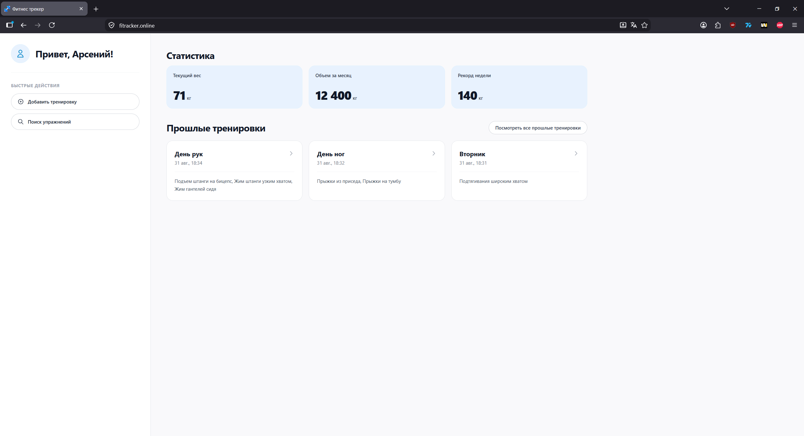
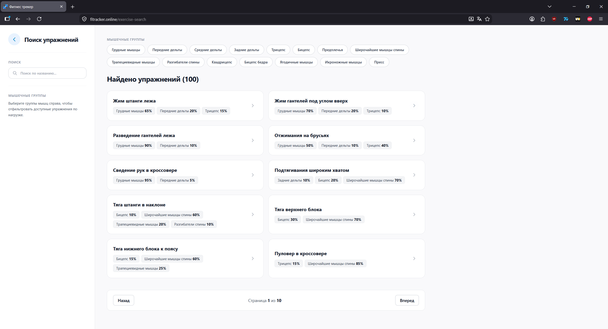
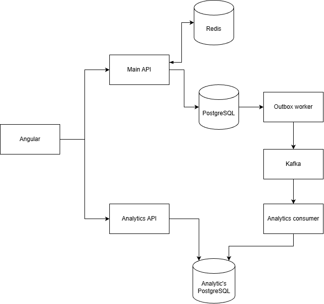
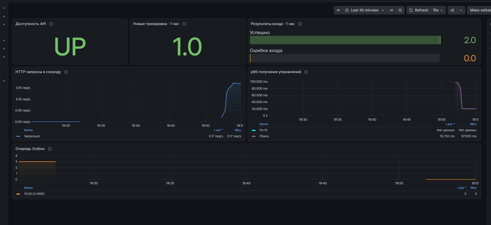
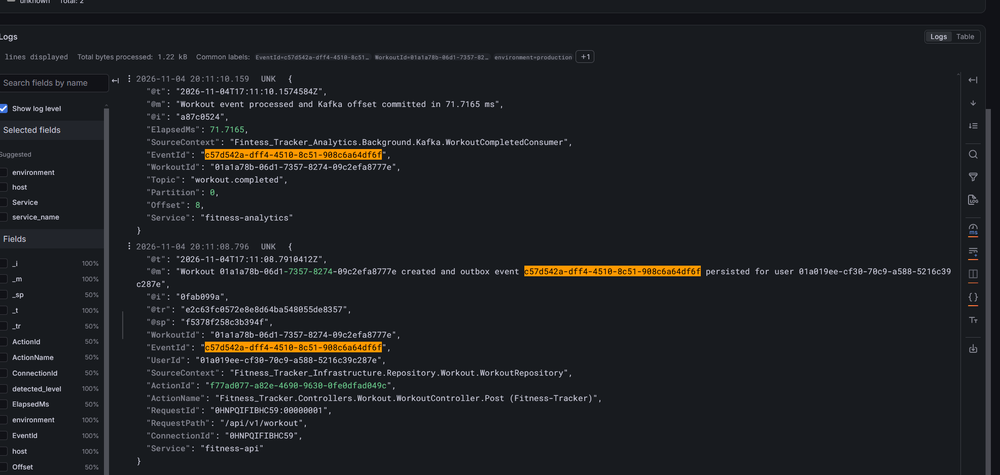

<div align="center">

# Fitness Tracker

**Дневник тренировок с асинхронной аналитикой и мониторингом приложения**


[Открыть приложение](https://fitracker.online) · [Frontend](https://github.com/murphyqwek/fintess-tracker-client) · [Запуск](#запуск) · [Метрики и логи](#метрики-и-логи)

</div>

Fitness Tracker помогает вести историю тренировок, находить упражнения и отслеживать тренировочный объём и силовые рекорды. Основной API сохраняет тренировки, а отдельный сервис аналитики получает события через Kafka и рассчитывает показатели прогресса.

Проект охватывает полный путь запроса: от Angular-интерфейса и JWT-аутентификации до PostgreSQL, Redis, Transactional Outbox, метрик Prometheus и структурированных логов в Grafana.

## Интерфейс

<div align="center">
  
  <p><em>История тренировок и аналитика на главном экране</em></p>
  
  <p><em>Каталог упражнений с поиском и фильтрами</em></p>
</div>

## Что реализовано

### Возможности приложения

- [x] Регистрация, вход и обновление сессии: пароли с BCrypt, JWT с RSA-подписью, refresh-токены в Redis, HttpOnly cookies.
- [x] Просмотр и изменение профиля пользователя.
- [x] Каталог упражнений: поиск по названию, фильтры по мышцам, пагинация и карточка упражнения.
- [x] Сохранение тренировок с упражнениями, весами и повторениями; просмотр деталей и истории с курсорной пагинацией.
- [x] Расчёт объёма за текущий месяц и недельного рекорда по оценочному одноповторному максимуму (e1RM).
- [x] Angular-интерфейс с TypeScript и Tailwind CSS в отдельном репозитории.

### Инженерные задачи

- [x] Разделение API, Application, Domain и Infrastructure; обработчики команд и запросов через MediatR, валидация через FluentValidation.
- [x] PostgreSQL и EF Core: миграции, индексы и отдельная схема `analytics` для результатов расчётов.
- [x] Redis Stack: кеширование, поиск упражнений через Redis Search и блокировка параллельных запросов по `Idempotency-Key`.
- [x] Transactional Outbox: тренировка и событие сохраняются одним `SaveChangesAsync`; фоновый обработчик публикует сообщения в Kafka.
- [x] Kafka consumer с ручным commit после сохранения аналитики и проверкой повторной доставки по `WorkoutId`.
- [x] HTTP-метрики и бизнес-метрики Prometheus; отдельный порт сбора через WireGuard.
- [x] JSON-логи Serilog, сбор контейнерных логов через Alloy, хранение в Loki и просмотр в Grafana.
- [x] Docker Compose, unit- и интеграционные тесты с Testcontainers, workflows сборки, тестирования и развёртывания в GitHub Actions.

## Как устроен проект

<div align="center">
  
  <p><em>Архитектура приложения</em></p>
</div>

После сохранения новой тренировки Outbox worker отправляет `WorkoutCompletedV1Event` в топик `workout.completed`. Consumer рассчитывает сумму `вес × повторения` и максимальный e1RM по подходам. Для нескольких повторений используется формула `вес × (1 + повторения / 30)`; для одного — сам вес.

Аналитика обновляется асинхронно. Доставка допускает повторы: consumer проверяет наличие расчёта по `WorkoutId`, а offset подтверждает после успешного сохранения. В текущей реализации событие создаётся для новой тренировки; изменение существующей тренировки не публикует новое событие пересчёта.

| Каталог | Назначение |
| --- | --- |
| [`Fitness-Tracker`](Fitness-Tracker) | HTTP API, аутентификация, middleware, регистрация зависимостей |
| [`Fitness-Tracker-Application`](Fitness-Tracker-Application) | Сценарии приложения, DTO, валидация и интерфейсы |
| [`Fitness-Tracker-Domain`](Fitness-Tracker-Domain) | Доменные модели |
| [`Fitness-Tracker-Infrastructure`](Fitness-Tracker-Infrastructure) | EF Core, репозитории, Redis, Outbox и реализация метрик |
| [`Fitness-Tracker-Shared`](Fitness-Tracker-Shared) | Общий контракт события тренировки |
| [`Fintess-Tracker-Analytics`](Fintess-Tracker-Analytics) | Рабочий сервис аналитики, Kafka consumer и миграции |
| [`Fitness-Tracker-Tests`](Fitness-Tracker-Tests) | Unit- и интеграционные тесты |
| [`Docker/monitoring`](Docker/monitoring) / [`Docker/alloy`](Docker/alloy) | Сервер мониторинга и агент сбора логов |

Название `Fintess-Tracker-Analytics` сохранено как в solution и Dockerfile. Для сборки используйте именно этот каталог.

## Запуск

Нужны Docker с Linux-контейнерами и Compose v2, .NET SDK 10 для миграций и OpenSSL для генерации ключей. Команды ниже рассчитаны на Bash в Linux или WSL; выполняйте их из корня репозитория. Docker должен быть запущен.

### 1. Подготовить окружение

```bash
git clone https://github.com/murphyqwek/Fitness-Tracker.git
cd Fitness-Tracker
cp .env.example .env
```

В `.env` задайте свои `DB_PASSWORD_APP` и `REDIS_PASSWORD`. Пример содержит все переменные Compose, включая пути ключей внутри контейнеров и `Kafka_Analytics_GroupId`. Для команд ниже используйте значения, совместимые с Bash; значения со специальными символами заключайте в одинарные кавычки.

Создайте отдельную пару ключей для локального запуска:

```bash
mkdir -p .local/keys
openssl genpkey -algorithm RSA -pkeyopt rsa_keygen_bits:2048 -out .local/keys/jwt_private.pem
openssl pkey -in .local/keys/jwt_private.pem -pubout -out .local/keys/jwt_public.pem
```

Каталог `.local/` исключён из Git и контекста Docker-сборки. На Linux приватный ключ должен читаться пользователем контейнера с UID/GID `1654`. Например, после генерации можно назначить группу `sudo chgrp 1654 .local/keys/jwt_private.pem` и права `chmod 640 .local/keys/jwt_private.pem`. Для production используйте собственные ключи и секреты.

### 2. Поднять инфраструктуру

Основной Compose явно задаёт порт аналитики `4545`. Локальный файл дополнительно публикует метрики API только на `127.0.0.1:9091`.

```bash
docker compose --env-file .env -f docker-compose.yml -f docker-compose.local.yml config --quiet
docker compose -f docker-compose.yml -f docker-compose.local.yml up -d db redis-stack kafka
docker compose -f docker-compose.yml -f docker-compose.local.yml exec db pg_isready
```

Дождитесь ответа `accepting connections`. `depends_on` задаёт порядок запуска, поэтому перед запуском приложения отдельно проверьте готовность инфраструктуры.

### 3. Применить миграции и заполнить справочники

В Compose используется `Production`: автоматического применения миграций и Swagger в этом режиме нет. Примените миграции обоих контекстов до запуска API и consumer.

Загрузите локальные настройки в текущую Bash-сессию и задайте адреса для подключения с хоста:

```bash
set -a
source .env
set +a
export ASPNETCORE_ENVIRONMENT=Production
export ConnectionStrings__DefaultConnection="Host=localhost;Port=${DB_OUT_PORT};Database=${DB_NAME};Username=${DB_USER_APP};Password=${DB_PASSWORD_APP}"
export ConnectionStrings__Redis="localhost:6379,password=${REDIS_PASSWORD}"
export Jwt__PublicKeyPath="$PWD/.local/keys/jwt_public.pem"
export Kafka__BootstrapServers=localhost:9092
export Kafka__GroupId="$Kafka_Analytics_GroupId"

# Выполните один раз, если dotnet-ef ещё не установлен.
dotnet tool install --global dotnet-ef --version '10.*'
dotnet restore Fitness-Tracker.slnx

dotnet ef database update --project Fitness-Tracker-Infrastructure --startup-project Fitness-Tracker
dotnet ef database update --project Fintess-Tracker-Analytics

docker compose -f docker-compose.yml -f docker-compose.local.yml exec -T db psql -v ON_ERROR_STOP=1 -U "$DB_USER_APP" -d "$DB_NAME" < "Database Scripts/init_exercise.sql"
```

`init_exercise.sql` заполняет 15 мышечных групп, 100 упражнений и связи между ними. Группы уже включены в этот файл; отдельно запускать `init_muscles.sql` для полного наполнения не нужно.

### 4. Собрать и запустить приложение

```bash
docker build -t fitness-tracker-api:local .
docker build -f Fintess-Tracker-Analytics/Dockerfile -t fitness-tracker-analytics:local .
docker compose -f docker-compose.yml -f docker-compose.local.yml up -d
docker compose -f docker-compose.yml -f docker-compose.local.yml ps
docker compose -f docker-compose.yml -f docker-compose.local.yml logs --tail=50 app analytcs
```

Теги сборки соответствуют `.env.example`. Если меняете `IMAGE_NAME` или `ANALYTICS_IMAGE_NAME`, используйте такие же теги в `docker build`.

| Сервис | Локальный адрес |
| --- | --- |
| Основной API | [localhost:8080/api/v1/exercise](http://localhost:8080/api/v1/exercise) |
| Analytics API | [localhost:4545/api/v1/analytics/monthly-volume](http://localhost:4545/api/v1/analytics/monthly-volume) — нужна авторизация |
| Метрики API | [127.0.0.1:9091/metrics](http://127.0.0.1:9091/metrics) |
| PostgreSQL | `localhost:5432` или порт `DB_OUT_PORT` |
| Redis Stack | `localhost:6379` |
| Kafka с хоста / внутри Compose | `localhost:9092` / `kafka:29092` |

Проверка API и метрик:

```bash
curl --fail 'http://localhost:8080/api/v1/exercise?page=1&size=5'
curl --fail http://127.0.0.1:9091/metrics
```

Основные маршруты: `POST /api/v1/auth/register`, `POST /api/v1/auth/login`, `POST /api/v1/auth/refresh`, `GET/PATCH /api/v1/user/me`, `GET/POST /api/v1/workout`, `GET /api/v1/workout/{id}`. Для сохранения тренировки передавайте заголовок `Idempotency-Key` со значением UUID.

Остановка с сохранением данных:

```bash
docker compose -f docker-compose.yml -f docker-compose.local.yml down
```

### Frontend

Клиент запускается отдельно; нужен Node.js, совместимый с Angular 20.

```bash
git clone https://github.com/murphyqwek/fintess-tracker-client.git
cd fintess-tracker-client
npm ci
npm start -- --ssl
```

Запускайте `npm ci` из каталога с `package.json`. Откройте [https://localhost:4200](https://localhost:4200); для локального сертификата браузеру может потребоваться подтверждение.

В `proxy.config.json` клиента настройте маршруты в таком порядке, чтобы аналитика попадала в свой сервис:

```json
{
  "/api/v1/analytics": {
    "target": "http://localhost:4545",
    "secure": false,
    "changeOrigin": true
  },
  "/api": {
    "target": "http://localhost:8080",
    "secure": false,
    "changeOrigin": true
  }
}
```

Cookies авторизации имеют флаги `Secure`, `HttpOnly`, `SameSite=Strict`, поэтому для проверки входа через браузер используйте HTTPS на frontend и проксирование API. В production HTTPS и маршрутизацию к двум API должен обеспечивать reverse proxy.

### Что измеряется

HTTP-метрики собирает `UseHttpMetrics()`. Бизнес-метрики реализованы в [`PrometheusFitnessMetrics`](Fitness-Tracker-Infrastructure/Metrics/PrometheusFitnessMetrics.cs) через интерфейс `IFitnessMetrics`.

| Метрика | Назначение |
| --- | --- |
| `http_requests_received_total` | Количество HTTP-запросов |
| `http_request_duration_seconds` | Гистограмма длительности HTTP-запросов |
| `http_requests_in_progress` | Запросы в обработке |
| `fitness_workouts_created_total` | Новые тренировки после сохранения в БД |
| `fitness_users_registered_total` | Новые пользователи после сохранения в БД |
| `fitness_login_attempts_total{result="success\|failure"}` | Завершённые проверки учётных данных по результату |
| `fitness_outbox_pending_messages` | Все сообщения Outbox с `ProcessedAt IS NULL` |
| `fitness_exercise_retrieval_duration_seconds{operation="search\|by_id"}` | Время поиска и получения упражнений, включая подготовку кеша |

В таблице `success|failure` и `search|by_id` обозначают допустимые значения меток. Счётчики сбрасываются при перезапуске процесса; историю хранит Prometheus. Это показатели работы приложения, а не итоговое число строк в БД. Gauge Outbox обновляется перед обработкой батча, обычно раз в две секунды; до первого успешного чтения БД он отсутствует. Гистограмма упражнений учитывает также ошибки и отмену; отказы валидации до обработчика не входят в счётчик проверок логина.

### Как собираются данные

- API отдаёт `/metrics` отдельным сервером на порту `9091`. На основном порту `8080` этот маршрут не публикуется. У сервиса аналитики отдельный endpoint метрик пока не настроен.
- В серверной конфигурации Prometheus опрашивает `10.50.0.1:9091` через WireGuard каждые **15 секунд**, таймаут — **5 секунд**. Локальный Compose-файл открывает endpoint только на localhost и не запускает весь стек мониторинга.
- Метрики хранятся **15 дней**, логи — **7 дней**, данные сохраняются в Docker volumes.
- Serilog пишет JSON с контекстом HTTP-запросов и обработки событий. Alloy читает логи контейнеров `app-container` и `analytcs-container` и отправляет их в Loki. Доступные поля `RequestId`, `TraceId`, `EventId`, `WorkoutId` помогают сопоставлять записи; наличие `TraceId` в логах не означает настроенную систему распределённой трассировки.
- Grafana автоматически получает источники Prometheus и Loki и дашборд **Fitness Tracker → Fitness API** с шестью панелями. Его [JSON](Docker/monitoring/grafana/dashboards/fitness-api.json) хранится в репозитории.

Для серверного развёртывания используйте инструкции [мониторинга](Docker/monitoring/README.md) и [Alloy](Docker/alloy/README.md). Они описывают запуск на двух Linux-серверах, WireGuard, публикацию порта метрик и доступ к Grafana через SSH-туннель. Для локального сбора потребуется изменить target Prometheus на адрес, доступный **из его контейнера**: `127.0.0.1` внутри контейнера указывает на сам контейнер.

### Панели Grafana

Дашборд загружается при запуске обновлённого стека мониторинга. Для существующей Grafana доступны [подключение через Compose и ручной импорт JSON](Docker/monitoring/README.md#дашборд-fitness-api). После подключения откройте папку **Fitness Tracker → Fitness API**; период по умолчанию — 30 минут, обновление — 15 секунд.

В Grafana выберите источник **Prometheus**. Для проверки сбора выполните `up{job="fitness-api"}`: значение `1` означает успешный последний опрос.



*Дашборд при демонстрационной нагрузке: доступность API, новые тренировки, результаты входа, частота HTTP-запросов, p95 получения упражнений и очередь Outbox.*

<details>
<summary><strong>PromQL для дашборда Fitness API</strong></summary>

**Частота запросов, запросов/с**

```promql
sum(rate(http_requests_received_total{job="fitness-api"}[5m]))
```

**p95 времени поиска упражнений, секунды**

```promql
histogram_quantile(0.95,
  sum by (le, operation) (
    rate(fitness_exercise_retrieval_duration_seconds_bucket{job="fitness-api"}[5m])
  )
)
```

**Новые тренировки за час**

```promql
sum(increase(fitness_workouts_created_total{job="fitness-api"}[1h]))
```

**Проверки логина за час по результату**

```promql
sum by (result) (increase(fitness_login_attempts_total{job="fitness-api"}[1h]))
```

**Очередь Outbox**

```promql
fitness_outbox_pending_messages{job="fitness-api"}
```

`rate` и `increase` требуют нескольких успешных опросов; значения `increase` могут быть дробными из-за экстраполяции Prometheus. Для пустого диапазона гистограмма может не показать p95.

</details>

### Обработка события в логах

В **Explore → Loki** логи обоих сервисов доступны по запросу:

```logql
{service_name=~"fitness-api|fitness-analytics"} | json
```

Для просмотра пути одной тренировки скопируйте `EventId` из записи API и подставьте его вместо `EVENT_UUID`:

```logql
{service_name=~"fitness-api|fitness-analytics"} |= "EVENT_UUID" | json
```



*Одно событие в двух сервисах: API сохраняет тренировку и Outbox-событие, consumer обрабатывает его и подтверждает Kafka offset.*

В обеих записях совпадают `EventId` и `WorkoutId`; поле `Service` указывает сервис. У consumer дополнительно видны `Topic`, `Partition`, `Offset` и время обработки `ElapsedMs`. Эти поля позволяют сопоставить сохранение тренировки с завершением обработки события.

Сценарий получения демонстрационных данных и обновления снимков — в [инструкции по скриншотам](docs/screenshots.md).

## Проверка качества

```bash
dotnet restore Fitness-Tracker.slnx
dotnet build Fitness-Tracker.slnx --no-restore
dotnet test Fitness-Tracker.slnx --no-build
```

Unit-тесты проверяют обработчики регистрации, входа, refresh-токенов, профиля, тренировок и упражнений, включая экспорт метрик. Интеграционные тесты поднимают PostgreSQL, Redis и Kafka через Testcontainers и проверяют репозитории и цепочку «сохранение тренировки → Outbox → Kafka → аналитика». Для них нужен работающий Docker; при первом запуске скачиваются образы.

Workflows в [`.github/workflows`](.github/workflows) выполняют сборку и тесты для `master`/`develop`, а также публикацию Docker-образов и обновление сервисов по SSH. Развёртывание требует настроенных GitHub Secrets.

## Дальнейшее развитие

- [ ] Графики прогресса рабочих весов и распределения нагрузки.
- [ ] Пользовательские шаблоны тренировок и таймер отдыха.
- [ ] Видео-примеры и расширенные инструкции по упражнениям.
- [ ] Telegram-бот для напоминаний и быстрых записей.
- [ ] Преобразование свободных заметок о тренировке в структурированные данные с помощью LLM.

## Лицензия

[MIT](LICENSE) · Copyright © 2026 murphyqwek.
